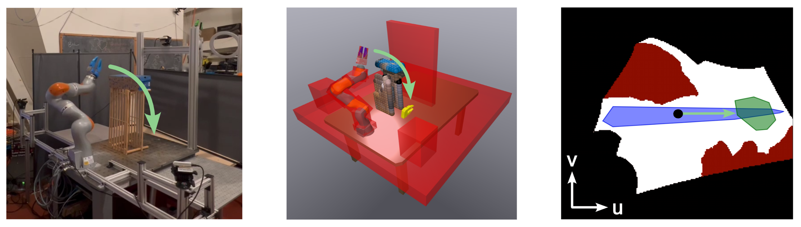

# CSDecomp: Configuration Space Decomposition Toolbox

> Historical toolbox documentation combining upstream guidance with earlier local
> Forest/FR3 reproduction notes. For the current Kinova benchmark and commands,
> use the [project README](README.md). This project uses the existing Conda
> environment; the upstream `uv` instructions below are historical reference.



CSDecomp is a Python package that implements a simple GPU-accelerated collision checker and GPU-accelerated algorithms for computing approximate convex decompositions of robot configuration spaces. The package provides implementations of Dynamic Roadmaps (DRMs) and the Edge Inflation Zero-Order (EI-ZO) algorithm in cuda/cpp as described in our paper ["Superfast Configuration-Space Convex Set Computation on GPUs for Online Motion Planning"](https://arxiv.org/pdf/2504.10783).

Since the publication I have continued adding useful functionality to this codebase for motion planning and have made it pip installable.

Contributions are welcome!

## Local paper reproduction

The latest [environment reconstruction](reproduction/environment_reconstruction/README.md)
recovers the Forest illustration from the authors' vector figure and builds FR3
tabletop tasks using public assets and explicit geometric assumptions. Its
[acceptance report](reproduction/reports/environment_reconstruction/report.md)
and interactive preview include actual native planning results and retained
failures; this is separate from the full benchmark below.

The [reproduction guide](reproduction/README.md) provides the Ubuntu 22.04 Conda
environment, runnable Forest/FR3 comparisons, validation, and saved evidence.
The current [constructed protocol](reproduction/paper_constructed/README.md)
builds a new 33-sphere FR3 model from pinned official geometry and fixes its
random tasks before planning. Its [experimental contract](reproduction/reports/paper_constructed/experimental_contract.md)
distinguishes published parameters from choices needed for missing author assets.
All five methods retain their trajectories, timings, and failures.

The [constructed-model audit](reproduction/reports/paper_constructed/geometry_audit.md)
and [v5 report](reproduction/reports/paper_constructed/reproduction_report.md)
record the corresponding checks and measured outcomes. The
[v4 report](reproduction/reports/paper_completion/reproduction_report.md) preserves
the earlier 800-case experiment, including its sphere-model defect. A separate
[paper-date core build](reproduction/reports/paper_completion/paperdate_core_result.json)
passed collision, DRM, and EI-ZO probes; the simulation runner still uses
csdecomp 0.1.2, since the historical core lacks the recovery interface.
These constructed experiments do not recover the original private models,
physical KUKA trials, or establish the paper's 17.1× speedup. Historical results
remain separate and unchanged.

The latest measured grids contain 400 Forest and 400 FR3 cases. A separate
[hardware-condition simulation](reproduction/reports/paper_constructed/hardware_simulation/report.md)
runs the public iiwa/WSG model with 35,000 input roadmap nodes and 15 fixed scene
changes, using synthetic obstacle clouds and independent solid-box checks.
The [result review](reproduction/reports/paper_constructed/posthoc_result_review.md)
explains the quantitative disagreements with the paper, including NTO failures
and the shorter constructed DRM paths.

The [systematic diagnosis](reproduction/reports/alignment_diagnosis/report.md)
adds measured explanations and controlled corrections for collision sampling,
time-spline transcription, integer-flow tolerances, and SCSTO initialization.
The original results remain unchanged; diagnostics and altered transcriptions
are reported separately.

## Installation

### From PyPI (recommended)

```bash
pip install csdecomp
```

Requires an NVIDIA GPU with a compatible driver. The wheel bundles the CUDA runtime.

### From source

1. Install the CUDA toolchain (12.x recommended): https://developer.nvidia.com/cuda-toolkit-archive

    (Your display driver must be compatible with the installed CUDA version.)

2. Install prereqs:

    Install bazel via bazelisk:
    [bazelisk instructions](https://github.com/bazelbuild/bazelisk/blob/master/README.md)

    Other prereqs:
    `sudo bash setup.sh`

3. Build and test:

    `bazel test //...`

    (If you are getting cudaMalloc errors, make sure there aren't any big applications running in the background.)

### Usage

```python
import csdecomp as csd
```

The build also outputs a pip-installable wheel at `bazel-bin/csdecomp/src/pybind/csdecomp/`.

To change Python version, edit `tools/my_python_version.bzl` and `MODULE.bazel`.

The unit tests demonstrate how the code should be used. The Python bindings closely follow the C++ syntax.
There is experimental documentation that can be built with doxygen: `cd csdecomp/docs/ && doxygen Doxyfile`.

## Running the Examples

The examples require [uv](https://docs.astral.sh/uv/getting-started/installation/) for environment management.

### As a user (using the PyPI package)

```bash
cd examples
uv sync
uv run python minimal_test.py
```

For notebooks:
```bash
uv run jupyter notebook
```
Select the `.venv` kernel in your editor.

### As a developer (using a locally built wheel)

```bash
cd examples
bash dev_install.sh          # builds wheel from source and installs it
uv run python minimal_test.py
uv run python test_eizo.py
uv run python test_drake_bridge.py
```

The example tests are also Bazel targets, so `bazel test //...` runs them alongside all other tests.

For notebooks, select the `.venv` kernel in your editor.

## Developing

Run the full test suite (requires GPU):

```bash
bazel test //...
```

CI runs lint and build checks only (no GPU required). Developers with a GPU should run the full suite locally before pushing.

For interactive debugging of C++ code with plotting, use the `cc_test_with_system_python` targets (tagged `manual`) in the test BUILD files. These require system Python with matplotlib and dev headers installed.

## Citation

If you find this code useful, please consider citing our paper:

```
@article{werner2024superfast,
  title={Superfast Configuration-Space Convex Set Computation on GPUs for Online Motion Planning},
  author={Werner, Peter and Cheng, Richard and Stewart, Tom and Tedrake, Russ and Rus, Daniela},
  journal={arXiv preprint arXiv:2504.10783},
  year={2025}
}
```

## Useful Commands

```bash
bazel build //...                                              # build everything
bazel build //csdecomp/src/pybind/csdecomp:csdecomp_wheel      # build pip wheel
bazel test //...                                               # run all tests (requires GPU)
bazel test //csdecomp/tests:csdecomp_test                      # run Python integration test
```

If Drake is slow to launch (LCM error):
```bash
sudo ifconfig lo multicast && sudo route add -net 224.0.0.0 netmask 240.0.0.0 dev lo
```
