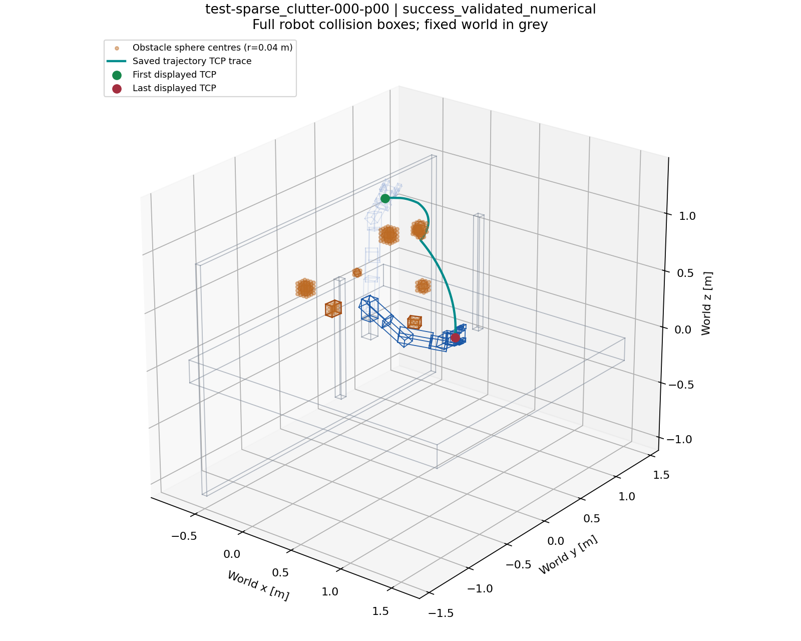

# Kinova Motion Planning Benchmark

A reproducible benchmark for **7-DoF Kinova Gen3 motion planning** in static, known obstacle scenes. Every problem fixes the robot, collision geometry, `q_start` and `q_goal` before planning. Two separate tracks measure **joint-space path length** and **constrained trajectory duration**.

Built on [CSDecomp](https://github.com/wernerpe/csdecomp), with native EI-ZO / LSCS / SCSTO, OMPL planners and declared trajectory-optimization baselines. Includes fixed inputs, resumable evaluation, independent numerical validation, raw successes and failures, and trajectory replay.

[Quick start](#quick-start) · [Dataset](#dataset) · [Methods](#methods) · [Results](#results) · [Protocol](#evaluation-protocol) · [Commands](#commands) · [Layout](#repository-layout)

<details>
<summary>View an actual benchmark scene and saved EI-ZO path</summary>



Numerically validated output for `test-sparse_clutter-000-p00`. The line is the end-effector trace; path length is measured in joint space. Orange markers show obstacle sphere **centers**, not full collision volumes. [Replay data](benchmarks/generic_motion_v1/results/figures/repaired_success/replay.json).

</details>

## Quick start

### Environment

Verified on **Ubuntu 22.04.5, Python 3.10.22, CSDecomp 0.1.2 and Drake 1.51.1**, with an NVIDIA Quadro RTX 8000 (48 GiB; driver 570.211.01). Planning requires a working NVIDIA GPU and the configured Conda environment, including native planner extensions.

```bash
git clone https://github.com/dingzhen60027/kinova-motion-benchmark.git
cd kinova-motion-benchmark
```

The configured checkout uses `.conda/envs/csdecomp` through `local/python.sh`. To reuse an environment elsewhere, set `CSDECOMP_CONDA_PREFIX` to its absolute path. The launcher resolves the repository root and isolates Python imports; it sets OpenBLAS/MKL threads to 1 and OMP threads to 4 by default.

[environment.yml](local/environment.yml), [the Conda lock](local/conda-explicit.txt), and [the pip lock](local/requirements.lock.txt) record installed packages. [Environment notes](local/README.md) describe the additional native dependencies. These files document the verified installation; a clean-machine installation of the complete baseline stack has not been validated.

### Check and run one problem

```bash
# Check frozen input hashes and references, then inspect available methods.
bash local/python.sh scripts/benchmark.py check
bash local/python.sh scripts/evaluate.py methods

# Execute real GPU collision, solver and positive/negative checks.
bash local/python.sh scripts/evaluate.py check

# Inspect a problem and run EI-ZO on both tracks.
bash local/python.sh scripts/benchmark.py show smoke-bottleneck-000-p00
bash local/python.sh scripts/evaluate.py run \
  --split smoke --problem smoke-bottleneck-000-p00 \
  --methods EI_ZO --track both --seeds 0 \
  --output runs/quickstart
bash local/python.sh scripts/evaluate.py verify --run runs/quickstart
```

Use a **new output directory** for each experiment. Continue an existing run with `resume`; completed failures are retained. From another working directory, invoke the launcher by its absolute path. Configurations and source hashes are captured before execution; commit runtime code changes before preparing a new experiment.

## Dataset

There is **one canonical dataset**. `benchmark/` is a filesystem alias for `benchmarks/generic_motion_v1/`; the internal package name is retained for import and evidence compatibility.

| Split | Purpose | Registered | Valid inputs | Generation failures |
|---|---|---:|---:|---:|
| `smoke` | Quick functional checks | 10 | 8 | 2 |
| `dev` | Development, configuration and regression tests | 60 | 60 | 0 |
| `test` | Designated baseline evaluation set | 420 | 395 | 25 |
| **Total** | | **490** | **463** | **27** |

The [problem index](benchmarks/generic_motion_v1/problems.jsonl) references stored scenes and endpoint arrays. [Splits](benchmarks/generic_motion_v1/splits.json), [features](benchmarks/generic_motion_v1/features.csv), and [metadata](benchmarks/generic_motion_v1/metadata.json) record membership, endpoint validity/distance, direct-connection checks, obstacle counts, generation failures, seeds and hashes.

| Category | Workspace geometry | Valid dev / test |
|---|---|---:|
| `sparse_clutter` | Mixture of spheres and boxes | 15 / 95 |
| `dense_clutter` | Dense spheres with a different size distribution | 15 / 85 |
| `bottleneck` | Two finite walls separated by a gap | 15 / 100 |
| `route_choice` | Two clusters of spheres | 15 / 95 |
| `open_control` | Fixed table/equipment without added random obstacles | 0 / 20 |

Scene and endpoint sampling use independent SHA256-derived PCG64 streams. All seven joint coordinates are sampled; inputs are selected by geometry, endpoint validity and distance criteria, never planner success. Planner seeds repeat fixed problems.

The valid test set contains **75 random layouts plus one shared base environment**. Problems within a layout are correlated. Dev/test random layouts are disjoint; open-control problems share the base environment. Test has historical evaluation exposure and is **not an untouched holdout**. Dev uses equal short/medium/long proportions; valid test uses 2:2:1. Both smoke generation failures are dense-clutter inputs.

Category names do not prove C-space passages or homotopy classes, and sparse/dense clutter is not a density-only comparison. Input validity does not prove a path exists: 418 problems have stored numerical path witnesses; the other 45 valid problems retain unknown feasibility. All 27 generation failures remain registered.

## Methods

The suite has **10 methods and 14 supported method–track combinations**. All share the model and final validator. Except for independent OMPL planners, methods start from an independently validated DRM path.

| Method ID | Implementation | Native objective | Tracks |
|---|---|---|---|
| `EI_ZO` | Native DRM → EI-ZO → author LSCS / SCSTO, using Clarabel; collision feedback and region/corridor repair retained | Corridor path length / duration | Path, time |
| `LGCS` | Perspective GCS MISOCP reconstruction using SCIP | Path length in the supplied region graph | Path |
| `NTO_PAPER` | Published-profile reconstruction in Drake KTO; SNOPT path / IPOPT time | Path-length transcription / duration | Path, time |
| `NTO_REFINED` | NTO adaptation with clearance, adaptive collision collocation and richer time splines | Path-length transcription / duration | Path, time |
| `NTO` | Legacy Drake KTO/IPOPT adaptation, kept as a distinct profile | Path-length transcription / duration | Path, time |
| `RRTCONNECT` | Official OMPL 2.0.1 RRTConnect and native vertex reduction | First feasible path, then shortening | Path |
| `RRTSTAR` | Official OMPL 2.0.1 RRT* with native rewiring and vertex reduction | Joint-space path length | Path |
| `CHOMP` | Covariant-gradient adaptation with a C-space clearance functional | Smoothness + obstacle cost | Path |
| `STOMP` | Official ros-industrial core with canonical collision and correlated-noise callbacks | Smoothness + obstacle cost | Path |
| `TRAJOPT` | Author SQP/BPMPD core with canonical collision collocation | Squared joint differences + collision constraints | Path |

CHOMP's C-space functional and TrajOpt's sampled collision constraints differ from the original workspace-body and swept-volume formulations. LGCS and NTO are mathematical reconstructions. See the [method catalog](benchmarks/generic_motion_v1/results/methods.json) and [source review](benchmarks/generic_motion_v1/results/trend_diagnostics/method_identity_review.json). SCSTO optimizes geometry and timing; it is the time backend of `EI_ZO`, not an additional method ID.

## Results

**Numerically validated successes** under the same frozen inputs and 60-second budget. Dev covers 60 problems at seeds **0, 1, 2**. Test covers 395 valid problems at **seed 0 only**; test seeds 1 and 2 have not been run.

| Method | Dev path / 180 | Dev time / 180 | Test path / 395 | Test time / 395 |
|---|---:|---:|---:|---:|
| `EI_ZO` | 131 | 131 | 338 | 338 |
| `LGCS` | 127 | — | 327 | — |
| `NTO_PAPER` | 44 | 101 | 113 | 269 |
| `NTO_REFINED` | 99 | 109 | 276 | 297 |
| `NTO` | 44 | 107 | 123 | 265 |
| `RRTCONNECT` | 146 | — | 362 | — |
| `RRTSTAR` | 129 | — | 316 | — |
| `CHOMP` | 130 | — | 336 | — |
| `STOMP` | 131 | — | 336 | — |
| `TRAJOPT` | 116 | — | 313 | — |

These are the completed `baseline_dev` and `baseline_test` cohorts at runtime commit `6c3144ff64`; run manifests preserve source hashes and effective settings. The later runtime passed 1,330 regression tests and three unchanged upstream tests. Another 28 planner calls recorded 10 validated successes and 18 classified failures/timeouts; these are separate functional diagnostics, not replacements for the table.

Smoke/dev/test contain **8,540 recorded calls**, including explicit invalid inputs. A separate shared-initial-region comparison adds 676 calls on 338 eligible problems. All 9,216 declared calls are complete, with zero infrastructure errors. Test outcomes include 4,009 successes, 759 searches without a solution, 140 timeouts, 369 validation failures, 253 solver failures, and 350 invalid-input calls (25 generation failures × 14 combinations).

| Evidence | Contents |
|---|---|
| [records.csv](benchmarks/generic_motion_v1/results/records.csv) | Actual attempts, including historical and diagnostic runs; filter by run identity |
| [summary.csv](benchmarks/generic_motion_v1/results/summary.csv) | Outcomes, latency, objectives and paired differences; filter by comparison identity |
| [selection.json](benchmarks/generic_motion_v1/results/selection.json) | Cohort definitions; main comparisons: `current_dev_repaired`, `current_test_repaired` |
| [Evaluation checks](benchmarks/generic_motion_v1/results/rigor_checks/completed_evaluation.json) | Completion, receipts, input/protocol identity and metrics |
| [Input and regression checks](benchmarks/generic_motion_v1/results/rigor_checks/checks.json) | Model/input rechecks, regression evidence and preserved historical results |

Cost comparisons use **paired common-success problems**, with full-denominator success rates alongside them and uncertainty clustered by physical scene. Do not pool historical cohorts or compare only each method's own successful subset.

## Evaluation protocol

Effective settings: [configs/evaluation.json](configs/evaluation.json). Geometry, joint limits and collision pairs: [robot.json](benchmarks/generic_motion_v1/configs/robot.json).

| Item | Shared definition |
|---|---|
| Robot | Full [Kinova model](csdecomp/tests/test_assets/directives/kinova_sens_on_table.yml); fixed base, welded Robotiq fingers; TCP `kinova::end_effector_link` |
| Joint metric | `kinova_joint_1_q` through `kinova_joint_7_q`; bounded Euclidean coordinates in radians, without angular wrapping |
| Obstacles | Fixed table/equipment plus conservative unions of 0.04 m radius spheres at frozen float32 centers |
| Path track | Actual saved PWL/curve length; composite solver costs are not substituted |
| Time track | Duration with joint velocity ≤ 1 rad/s, acceleration ≤ 1 rad/s², zero endpoint velocity; endpoint acceleration bounded, not fixed to zero |
| Validation | Endpoints, bounds, continuity, self/environment collision and applicable derivatives; CUDA and independent double-precision geometry checks |
| Collision resolution | Maximum final joint step 0.005 rad; the ±2 μm contact band does not count as validated success |
| Online budget | 60 s/query including startup, setup, frontend, optimization, repair, validation and output; one GPU planning job at a time |
| Offline work | 6,000-node roadmaps at seeds 0, 1, 2; construction time and storage reported separately |
| Repetitions | First terminal attempt per declared job; no best-of retry selection |

**Comparison modes.** Full-flow evaluation includes each method's frontend. Fixed-frontend summaries condition on an identical validated seed path. `fixed_initial_regions` gives EI-ZO and LGCS the same saved path and initial regions under a fresh backend budget; source frontend costs remain separate. Conditional and full-flow results are not pooled.

**Timing.** Computation time and trajectory execution time are distinct. Cold end-to-end time includes startup; `within_call` is a decomposition of that run, not a separately measured warm-start experiment. First-valid-solution times and progress curves appear only when actually observed. OMPL reserves budget for validation and simplification; settings and thread policies are captured per run.

**Outcomes.** The normalized statuses are `success_numerical`, `invalid_input`, `no_solution_within_budget`, `timeout`, `solver_failure`, `validation_failed`, and `infrastructure_error`. Solver convergence and numerical validity are separate fields. Numerical sampling is not a continuous mathematical certificate; timeout does not prove infeasibility. NTO's failures include collisions between constraint points, which remain validation failures.

## Commands

Run from the repository root through the existing Conda launcher. Each entry point and subcommand supports `--help`.

### Batch, resume and verify

```bash
# Prepare 60 dev problems × 3 paired seeds × 2 path methods.
bash local/python.sh scripts/evaluate.py batch \
  --split dev --methods EI_ZO RRTCONNECT --track path --seeds 0 1 2 \
  --output runs/dev-comparison --prepare-only
bash local/python.sh scripts/evaluate.py resume --run runs/dev-comparison
bash local/python.sh scripts/evaluate.py status --run runs/dev-comparison
bash local/python.sh scripts/evaluate.py verify --run runs/dev-comparison
```

Omit `--methods` to select all supported methods; `--track both` runs their supported tracks. Single-problem/smoke runs default to seed 0; dev/test batches default to 0, 1, 2. `resume --max-jobs N` limits a session. Completed jobs are not rerun, and runtime-hash mismatches prevent incomplete historical runs from silently continuing with changed code.

### Summarize and replay

```bash
# Recompute the published comparisons into a separate output directory.
bash local/python.sh scripts/evaluate.py summarize \
  --selection results/selection.json --output runs/published-summary

# Replay a saved successful path; output includes replay.html.
bash local/python.sh scripts/evaluate.py replay \
  --attempt results/baseline_test/jobs/test-sparse_clutter-000-p00-EI_ZO-minimum_distance-3cafa806/attempts/0001 \
  --output runs/replay-example
```

Use another trajectory's `attempt_path` from `records.csv` to replay it. For new comparisons, adapt the existing selection schema to reference your run; keep historical comparison identities distinct. Summaries retain failures, pending work, stage timings and scene-cluster paired statistics.

### Regenerate inputs and build a roadmap

```bash
# Uses the frozen dev configuration and generation seed by default.
bash local/python.sh scripts/benchmark.py generate \
  --split dev --output runs/regenerated-dev

# Offline operation, outside online query timing.
bash local/python.sh scripts/benchmark.py build-roadmap \
  --nodes 6000 --seed 0 --output runs/roadmap-rebuild
```

Generation accepts `--seed` and `--config` overrides and requires a separate new destination. `benchmark.py index` rebuilds the reference index without resampling inputs. `benchmark.py check` checks hashes and references; it does not rerun the full collision audit.

### Run tests

```bash
bash local/python.sh -m pytest -q
bash local/python.sh -m pytest -q --import-mode=prepend \
  csdecomp/tests/csdecomp_test.py csdecomp/tests/drake_dep_test.py
```

The second command checks the installed upstream package with its required import mode. GPU-dependent tests need the verified environment. Upstream CI workflows are preserved as inactive examples in `.github/workflow-examples/`; automated GPU CI is not configured.

## Repository layout

```text
.
├── README.md                        # Current dataset, methods, protocol and commands
├── environment.yml                  # Alias to local/environment.yml
├── configs/                         # Public evaluation / generation configuration
├── scripts/                         # benchmark.py and evaluate.py entry points
├── benchmark/                       # Alias to benchmarks/generic_motion_v1/
│   ├── problems.jsonl, splits.json   # Canonical problems and split membership
│   ├── features.csv, metadata.json  # Characteristics, model and provenance
│   ├── scenes/, inputs/, manifests/ # Frozen geometry, endpoints and original records
│   ├── generator/, model.py         # Generation and canonical robot model
│   ├── runners/                     # Adapters, validation, statistics and replay
│   ├── native/, roadmaps/           # Native extensions and offline roadmaps
│   └── tests/                       # Benchmark / planner regression tests
├── results/                         # Alias to benchmark/results/; published evidence
│   ├── records.csv, summary.csv     # Actual attempts and selected comparisons
│   ├── selection.json              # Cohort definitions
│   └── baseline_*/                  # Run manifests, trajectories, receipts and logs
├── local/                           # Conda launcher and package records
├── csdecomp/, examples/             # Preserved upstream library and examples
├── tests/                           # Cross-package regression tests
├── reproduction/, research_platform/ # Retained Forest/FR3 work and dependencies
└── runs/                            # Git-ignored new local experiment outputs
```

Historical source capsules, trajectories and failure logs remain at their referenced paths. [Legacy toolbox documentation](README.legacy.md) and the [Forest/FR3 runner](research_platform/README.md) describe separate earlier work, not the current Kinova protocol.

To add a planner, implement an adapter in [runners/](benchmarks/generic_motion_v1/runners/), declare its identity/objectives in [methods.py](benchmarks/generic_motion_v1/runners/methods.py), and connect it to the existing [worker dispatch](benchmarks/generic_motion_v1/batch.py). Reuse frozen inputs, validation and result contracts; add a targeted test and configuration.

## Attribution and license

This Kinova suite uses the methods of Werner et al. on its own fixed dataset. It does not reproduce the paper's private Franka/FR3 inputs or physical KUKA trials. Cite the implementation and dataset configuration used in your experiment.

Upstream paper: [*Superfast Configuration-Space Convex Set Computation on GPUs for Online Motion Planning*, RSS 2025](https://www.roboticsproceedings.org/rss21/p045.html).

```bibtex
@inproceedings{WernerP-RSS-25,
  author    = {Peter Werner and Richard Cheng and Tom Stewart and Russ Tedrake and Daniela Rus},
  title     = {Superfast Configuration-Space Convex Set Computation on GPUs for Online Motion Planning},
  booktitle = {Proceedings of Robotics: Science and Systems},
  year      = {2025},
  doi       = {10.15607/RSS.2025.XXI.045}
}
```

The [MIT license](LICENSE) and upstream authorship are preserved. Robot assets, vendored algorithms and solver dependencies retain their own licenses and source notices; this repository's license does not replace them.
