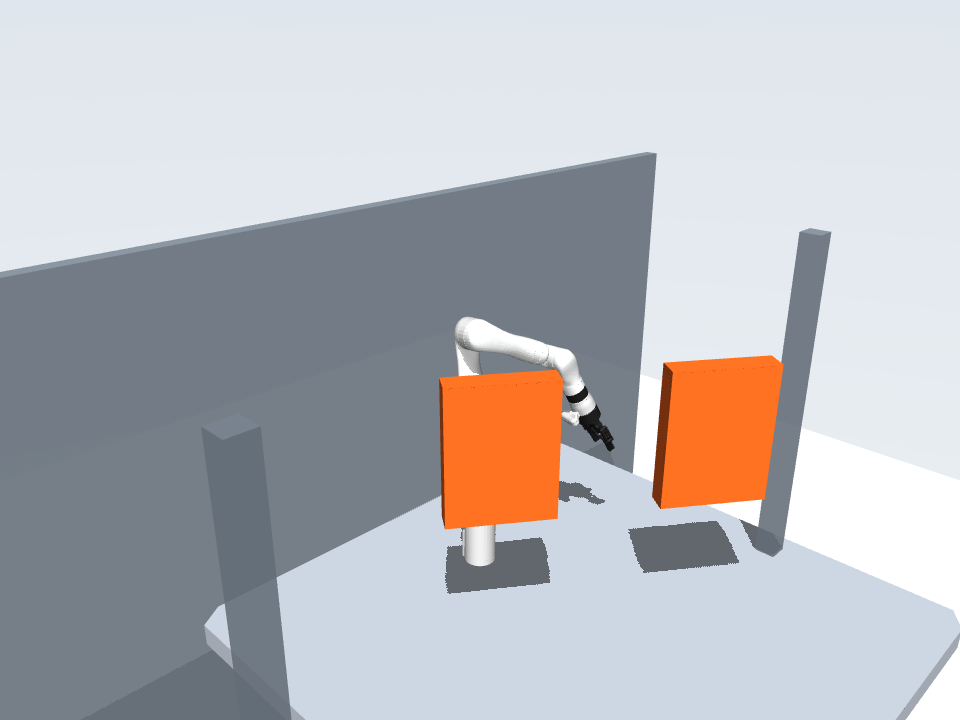

# Kinova Motion Planning Benchmark

A benchmark for **7-DoF robot motion planning** with fixed start/goal configurations and static obstacles, built on [CSDecomp](https://github.com/wernerpe/csdecomp). Compare **path length** and **trajectory duration** using shared inputs, validation and evaluation scripts.

[Environment](local/README.md) · [Benchmark guide](benchmarks/generic_motion_v1/README.md) · [Configuration](configs/evaluation.json) · [Results](benchmarks/generic_motion_v1/results/nto_metis/comparison/summary.csv)

## Setup and quick start

The tested setup is **Ubuntu 22.04, an NVIDIA GPU, and Conda Python 3.10**. Follow these steps in the existing configured repository. For a fresh machine, start with the [installation guide](local/README.md#new-machine-python-dependencies).

### 1. Check the GPU

From the repository root:

```bash
nvidia-smi
```

The command should list your NVIDIA GPU and driver without an error.

### 2. Select the Conda environment

```bash
export CSDECOMP_CONDA_PREFIX="$PWD/.conda/envs/csdecomp"
bash local/python.sh -c 'import sys, csdecomp, pydrake; print(sys.executable); print(csdecomp.__file__); print(pydrake.__file__)'
```

If your existing environment is elsewhere, replace the prefix with its absolute path. All three printed paths should be inside that environment. The launcher selects Python directly; `conda activate` is unnecessary.

### 3. Check dependencies and inputs

```bash
bash local/python.sh -m pip check
bash local/python.sh scripts/benchmark.py check
bash local/python.sh scripts/evaluate.py check
```

Expect `No broken requirements found` and passing dataset/core runtime checks. The runtime check executes GPU collision queries and Clarabel solves. Additional planner dependencies are listed in the [environment guide](local/README.md#native-planner-dependencies).

### 4. Run one problem

```bash
bash local/python.sh scripts/evaluate.py run \
  --split smoke --problem smoke-bottleneck-000-p00 \
  --methods EI_ZO --track both --seeds 0 \
  --output runs/example
bash local/python.sh scripts/evaluate.py verify --run runs/example
```

Use a new output directory. Verification should report `integrity_passed: true` and `complete: true`; each planner outcome is recorded separately. To continue an interrupted run, use `resume --run runs/example`. [Batch evaluation, summaries and replay →](benchmarks/generic_motion_v1/README.md#commands)

## Complete baseline experiment

The formal entry uses `configs/evaluation.json`: **14 method–objective pairs, seeds 0/1/2, paired 6,000-node roadmaps, 60 seconds per query, one GPU worker at a time**. It checks the environment and frozen inputs, then runs Smoke → Dev → Test. All 463 legal problems are included: **19,446 calls**, with path and time results reported separately.

```bash
# 1. Check dependencies and execute all 14 combinations on a fixed smoke problem.
bash local/python.sh scripts/run_baselines.py smoke-check

# 2. Continue the full experiment in tmux; survives SSH disconnection.
bash local/python.sh scripts/run_baselines.py start

# 3. Inspect progress and logs.
bash local/python.sh scripts/run_baselines.py status
tail -f runs/end_to_end/console.log
```

The tmux session is `kinova-baselines`. After interruption, rerun `start` once that session has exited, or use `resume` for foreground execution. Completed successes **and failures** are skipped; interrupted attempts remain preserved. Infrastructure errors or changed inputs, code or dependencies stop the pipeline.

`verify` checks the complete matrix and saved evidence; `summarize` writes `runs/end_to_end/analysis/{records,summary}.csv`, figures and artifact links. Both run automatically at completion. `matrix.csv` records every planned call and its reuse provenance; historical results without compatible sealed evidence are kept separate. Run data stays under `runs/end_to_end/` and is not committed to Git.

## Benchmark

Kinova Gen3 with a fixed gripper, table/equipment and five obstacle categories: **sparse clutter, dense clutter, bottleneck, route choice, open control**.

| Split | Use | Valid / registered problems |
|---|---|---:|
| `smoke` | Quick functional checks | 8 / 10 |
| `dev` | Development and configuration | 60 / 60 |
| `test` | Baseline evaluation | 395 / 420 |

Generation failures remain recorded. The valid test set covers 75 random layouts plus a shared base environment; it has prior evaluation exposure. This is a Kinova benchmark, distinct from the original paper's Franka experiments. [Data and protocol details →](benchmarks/generic_motion_v1/README.md)

## Baselines and results

Historical validated successes on **395 test problems, seed 0, 60 seconds/query**. These rows predate the unified three-seed experiment above; they are not its final results. Validation is numerical, not a continuous collision certificate.

| Method | Path | Time |
|---|---:|---:|
| DRM + EI-ZO + LSCS / SCSTO | 338 | 338 |
| LGCS reconstruction | 327 | — |
| NTO published-profile reconstruction | 113 | 269 |
| NTO refined adaptation | 276 | 302 |
| NTO legacy adaptation (historical profile) | 123 | 265 |
| OMPL RRTConnect | 362 | — |
| OMPL RRT* | 316 | — |
| CHOMP adaptation | 336 | — |
| STOMP official core | 336 | — |
| TrajOpt adaptation | 313 | — |

All methods share the final validator. Path length and execution duration are evaluated separately from computation time; cost comparisons use paired common-success problems. [Method definitions](benchmarks/generic_motion_v1/README.md#methods) · [Raw records](benchmarks/generic_motion_v1/results/nto_metis/comparison/records.csv) · [Selected comparisons](benchmarks/generic_motion_v1/results/nto_metis/comparison/selection.json)

The refined NTO row uses the completed METIS/MC64 retest: **1,220 registered calls**, including smoke, dev and test, with zero native crashes. Other rows retain their existing runs. [Completion checks and matched before/after results](benchmarks/generic_motion_v1/results/nto_metis/comparison/verification.json) preserve the historical scores separately.

The three NTO rows are configurations of one method family. `NTO_REFINED` is the strengthened comparison profile; the other two preserve the published-parameter reconstruction and historical configuration. [Configuration differences and verified failure causes →](benchmarks/generic_motion_v1/README.md#nto-profiles-and-failure-analysis)

## Simulation

Execute saved time trajectories in **MuJoCo 3.3.7**, with gravity, source-model inertia, torque limits, contact and independent collision checks. The simulator reuses the existing problems and exact trajectory coefficients; execution results stay separate from planning scores. [Install and run](local/README.md#optional-mujoco-simulation) · [Execution protocol](benchmarks/generic_motion_v1/README.md#mujoco-execution) · [Demo video](benchmarks/generic_motion_v1/results/mujoco_smoke/demo/render/rollout.mp4)



## Project structure

```text
scripts/      Dataset and evaluation CLI
configs/      Experiment configuration
benchmark/    Fixed problems, scenes, planner adapters and validator
results/      Recorded runs, summaries, trajectories and logs
local/        Conda launcher and dependency records
csdecomp/     Upstream C++/CUDA library
```

`benchmark/` and `results/` are aliases to the existing benchmark package and its outputs. [Full reference and extension points →](benchmarks/generic_motion_v1/README.md)

## Acknowledgments

Based on Werner et al., [*Superfast Configuration-Space Convex Set Computation on GPUs for Online Motion Planning*, RSS 2025](https://www.roboticsproceedings.org/rss21/p045.html). Method sources and implementation differences are documented in the [benchmark guide](benchmarks/generic_motion_v1/README.md#methods).

[MIT license](LICENSE). Upstream code, robot assets and third-party dependencies retain their respective licenses and attribution.
