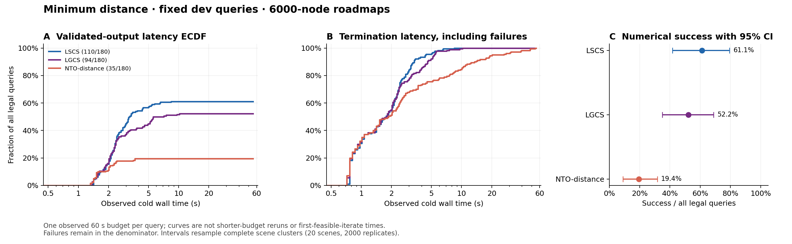
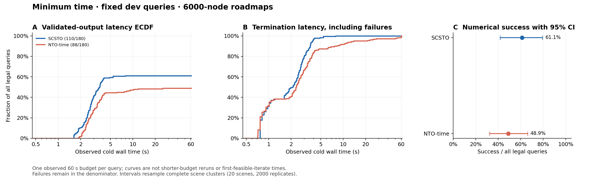

# Kinova 通用运动规划：论文 baseline 指标

本报告读取已封存、重新核验的 **900 次 dev 运行**：60 个固定问题、20 个障碍场景、3 个请求 6000 节点 DRM、五种论文方法。计算源码 commit 为 `72984027030175b7bca78e2dcf592b38f0c1864b`。距离和时间目标分开比较。结果是 Kinova 适配，不是作者 FR3/实机实验的精确复跑。

数值成功要求固定输入合法、原生 DRM 成功、seed 独立检查通过、优化器返回成功且最终轨迹通过共同验证。失败、超时、许可证阻塞和进程异常均保留。有限碰撞采样不是连续安全证明。

## 有效成功率与共同前端

所有主成功率以全部合法查询为分母。方括号为场景整组 bootstrap 95% 区间：2000 次、PCG64 seed 45827；同场景端点和路网重复保持成组。条件率用于定位失败阶段，不能替代主分母。

这些区间反映当前有限场景的经验重采样不确定性。分层只有少量独立场景时估计较弱；全成功或全失败会产生退化的 [100%, 100%] 或 [0%, 0%] bootstrap 区间，不能证明总体成功概率恰为 1 或 0。

### 最短距离

| 方法 | 有效成功 / 合法查询；95% CI | 成功 / 原生 DRM 成功 | 成功 / 严格 seed 准入 | 许可/依赖限制 | 基础设施异常 |
| --- | --- | --- | --- | --- | --- |
| LSCS | 110/180; 61.11 [41.67, 79.46]% | 110/111; 99.10 [97.06, 100.00]% | 110/110; 100.00 [100.00, 100.00]% | 0 | 1 |
| LGCS | 94/180; 52.22 [35.00, 68.89]% | 94/111; 84.68 [73.53, 93.94]% | 94/110; 85.45 [74.35, 94.44]% | 16 | 1 |
| NTO-distance | 35/180; 19.44 [8.89, 31.67]% | 35/111; 31.53 [16.84, 47.46]% | 35/110; 31.82 [17.14, 47.71]% | 0 | 1 |

### 最短时间

| 方法 | 有效成功 / 合法查询；95% CI | 成功 / 原生 DRM 成功 | 成功 / 严格 seed 准入 | 许可/依赖限制 | 基础设施异常 |
| --- | --- | --- | --- | --- | --- |
| SCSTO | 110/180; 61.11 [41.67, 79.46]% | 110/111; 99.10 [97.06, 100.00]% | 110/110; 100.00 [100.00, 100.00]% | 0 | 1 |
| NTO-time | 88/180; 48.89 [32.22, 66.11]% | 88/111; 79.28 [67.27, 90.36]% | 88/110; 80.00 [68.22, 90.91]% | 0 | 1 |

LGCS 的许可证限制单独解释：94/180 是当前部署的有效输出率。110 条准入 seed 中有 16 个 MISOCP 被受限许可证拒绝。实际通过验证的输出数为 94。这不证明 LGCS 优化算法比 LSCS 更不可靠。未进入优化器的查询，后端规模支持性仍未知。

以下辅助口径只去除**观察到**依赖或基础设施失败，不表示其他案例获得一般性求解支持保证，也不消除规模选择偏差。

| 方法 | 无观察到依赖/基础设施故障 | 在该子集上的成功 | 在该子集且 seed 准入后的成功 |
| --- | --- | --- | --- |
| LSCS | 179/180; 99.44 [98.33, 100.00]% | 110/179; 61.45 [42.13, 80.00]% | 110/110; 100.00 [100.00, 100.00]% |
| LGCS | 163/180; 90.56 [82.78, 96.11]% | 94/163; 57.67 [38.01, 76.97]% | 94/94; 100.00 [100.00, 100.00]% |
| NTO-distance | 179/180; 99.44 [98.33, 100.00]% | 35/179; 19.55 [8.99, 31.84]% | 35/110; 31.82 [17.14, 47.71]% |
| SCSTO | 179/180; 99.44 [98.33, 100.00]% | 110/179; 61.45 [42.13, 80.00]% | 110/110; 100.00 [100.00, 100.00]% |
| NTO-time | 179/180; 99.44 [98.33, 100.00]% | 88/179; 49.16 [32.78, 66.48]% | 88/110; 80.00 [68.22, 90.91]% |

### 全部合法失败的分类

| 方法 | frontend_failed | solver_failed | collision_failed | limit_failed | validation_undetermined | timeout | unsupported | infrastructure_error |
| --- | --- | --- | --- | --- | --- | --- | --- | --- |
| LSCS | 69 | 0 | 0 | 0 | 0 | 0 | 0 | 1 |
| LGCS | 69 | 0 | 0 | 0 | 0 | 0 | 16 | 1 |
| NTO-distance | 69 | 30 | 45 | 0 | 0 | 0 | 0 | 1 |
| SCSTO | 69 | 0 | 0 | 0 | 0 | 0 | 0 | 1 |
| NTO-time | 69 | 1 | 18 | 0 | 0 | 3 | 0 | 1 |

`solver_failed` 包含保存的后端数值异常，不能自动归为算法无解；完整诊断见 [NTO 后端错误](full_baseline/nto_backend_failures.md)。原生 DRM 失败或断言也不是连续配置空间不可行的证明。

## 实际延迟与输出累积分布

冷耗时是外层进程墙钟，包含启动、模型/地图载入、依赖探测、GPU 初始化、规划、验证及输出。下表包含所有合法失败，缺失值绝不填零。warm 是同次执行去除初始化的阶段，不是独立热启动实验。超时清理可使观察墙钟略超 60 s。

### 距离目标延迟

| 方法 | 合法冷耗时 n | 冷 p50 / p90 / p95 (s) | 冷最大 (s) | warm p50 (s; observed n) |
| --- | --- | --- | --- | --- |
| LSCS | 180 | 1.767 / 3.368 / 4.374 | 8.427 | 1.075; n=179 |
| LGCS | 180 | 1.792 / 4.573 / 5.324 | 10.231 | 1.111; n=179 |
| NTO-distance | 180 | 1.867 / 13.495 / 20.515 | 54.144 | 1.165; n=179 |



### 时间目标延迟

| 方法 | 合法冷耗时 n | 冷 p50 / p90 / p95 (s) | 冷最大 (s) | warm p50 (s; observed n) |
| --- | --- | --- | --- | --- |
| SCSTO | 180 | 2.092 / 3.619 / 3.872 | 7.926 | 1.386; n=179 |
| NTO-time | 180 | 2.343 / 7.690 / 14.207 | 60.214 | 1.612; n=176 |



图 A 的分母始终是全部合法查询；未产生有效输出的任务保留在无穷延迟处，曲线平台即主成功率。图 B 显示所有合法任务的终止耗时，包括快速失败。图 A/B 均来自一次固定 60 s 预算的实际记录，**不是**短预算重跑，也不是首次可行迭代时间；快速失败不能解释成更快产出有效轨迹。

## 成本与成对比较

下表仅描述各方法自己的成功样本，不能用不同成功子集的均值排名。距离成本单位 rad，时间成本为物理轨迹持续时间 s。成本/端点参考使用忽略障碍的弦长或独立关节静止到静止运动松弛；不是经验最优值或紧的最优性差距。

| 距离方法 | 成功成本 observed n | 成本均值 / p50 (rad) | 成本/端点参考均值 (n) | 相对同题 seed 长度改善均值 (n) |
| --- | --- | --- | --- | --- |
| LSCS | 110 | 6.373 / 6.799 | 1.209 (n=110) | 9.865 (n=110)% |
| LGCS | 94 | 6.038 / 6.272 | 1.141 (n=94) | 9.144 (n=94)% |
| NTO-distance | 35 | 4.675 / 3.605 | 1.000 (n=35) | 1.389 (n=35)% |

| 同目标 A − B | 全部合法配对 n | 主成功率差 pp [CI] | 共同成功 n | 共同成功成本差 (rad) [CI] | 共同成功冷耗时差 s [CI] | 全部合法冷耗时差 s [CI] |
| --- | --- | --- | --- | --- | --- | --- |
| LGCS − LSCS | 180 | -8.89 [-16.11, -3.33] | 94 | -0.082 [-0.153, -0.027] | 0.348 [0.126, 0.665] | 0.215 [0.063, 0.384] |
| LGCS − NTO-distance | 180 | 32.78 [20.00, 45.56] | 35 | 0.010 [0.000, 0.039] | -0.037 [-0.185, 0.029] | -3.081 [-4.694, -1.643] |
| LSCS − NTO-distance | 180 | 41.67 [26.67, 57.78] | 35 | 0.010 [-0.000, 0.039] | -0.014 [-0.171, 0.056] | -3.296 [-4.999, -1.789] |

| 时间方法 | 成功成本 observed n | 成本均值 / p50 (s) | 成本/端点参考均值 (n) | 相对同题 seed 长度改善均值 (n) |
| --- | --- | --- | --- | --- |
| SCSTO | 110 | 5.799 / 5.698 | 1.297 (n=110) | 不适用 |
| NTO-time | 88 | 6.816 / 5.899 | 1.530 (n=88) | 不适用 |

| 同目标 A − B | 全部合法配对 n | 主成功率差 pp [CI] | 共同成功 n | 共同成功成本差 (s) [CI] | 共同成功冷耗时差 s [CI] | 全部合法冷耗时差 s [CI] |
| --- | --- | --- | --- | --- | --- | --- |
| NTO-time − SCSTO | 180 | -12.22 [-20.00, -5.00] | 88 | 1.303 [0.410, 2.244] | 0.943 [0.496, 1.536] | 2.538 [1.149, 4.089] |

差值方向严格为 A−B。成本和相应共同成功耗时均条件于同题双方成功；总体耗时差保留合法失败。许可/基础设施条件筛选只作为辅助分析，不能消除由模型规模和失败造成的选择效应。

## 场景族、直连状态和距离分层

分层在方法运行前固定，表内给有效成功/该层合法查询及 95% CI。直连状态来自数值采样；bottleneck 与 route_choice 描述 workspace 几何，不声称已知 C-space 同伦。

### 距离目标分层

| 固定分层 | 独立场景数 | LSCS | LGCS | NTO-distance |
| --- | --- | --- | --- | --- |
| 障碍族：sparse_clutter | 5 | 18/45; 40.00 [4.44, 75.56]% | 17/45; 37.78 [4.44, 73.33]% | 0/45; 0.00 [0.00, 0.00]% |
| 障碍族：dense_clutter | 5 | 8/45; 17.78 [0.00, 44.44]% | 7/45; 15.56 [0.00, 37.78]% | 2/45; 4.44 [0.00, 13.33]% |
| 障碍族：bottleneck | 5 | 45/45; 100.00 [100.00, 100.00]% | 35/45; 77.78 [55.56, 93.33]% | 12/45; 26.67 [13.33, 33.33]% |
| 障碍族：route_choice | 5 | 39/45; 86.67 [60.00, 100.00]% | 35/45; 77.78 [46.67, 100.00]% | 21/45; 46.67 [20.00, 80.00]% |
| 直连：采样检测到碰撞 | 19 | 75/141; 53.19 [33.33, 73.81]% | 59/141; 41.84 [25.85, 59.03]% | 0/141; 0.00 [0.00, 0.00]% |
| 直连：采样未检测到碰撞 | 10 | 35/39; 89.74 [70.00, 100.00]% | 35/39; 89.74 [70.00, 100.00]% | 35/39; 89.74 [70.00, 100.00]% |
| 规范化端点距离：short | 20 | 38/60; 63.33 [43.33, 83.33]% | 35/60; 58.33 [38.33, 78.33]% | 20/60; 33.33 [15.00, 53.33]% |
| 规范化端点距离：medium | 20 | 38/60; 63.33 [43.33, 81.67]% | 28/60; 46.67 [28.33, 65.00]% | 6/60; 10.00 [0.00, 25.00]% |
| 规范化端点距离：long | 20 | 34/60; 56.67 [36.67, 76.67]% | 31/60; 51.67 [33.33, 71.67]% | 9/60; 15.00 [0.00, 30.00]% |

### 时间目标分层

| 固定分层 | 独立场景数 | SCSTO | NTO-time |
| --- | --- | --- | --- |
| 障碍族：sparse_clutter | 5 | 18/45; 40.00 [4.44, 75.56]% | 11/45; 24.44 [4.44, 44.44]% |
| 障碍族：dense_clutter | 5 | 8/45; 17.78 [0.00, 44.44]% | 7/45; 15.56 [0.00, 37.78]% |
| 障碍族：bottleneck | 5 | 45/45; 100.00 [100.00, 100.00]% | 42/45; 93.33 [80.00, 100.00]% |
| 障碍族：route_choice | 5 | 39/45; 86.67 [60.00, 100.00]% | 28/45; 62.22 [31.06, 88.89]% |
| 直连：采样检测到碰撞 | 19 | 75/141; 53.19 [33.33, 73.81]% | 53/141; 37.59 [21.57, 55.56]% |
| 直连：采样未检测到碰撞 | 10 | 35/39; 89.74 [70.00, 100.00]% | 35/39; 89.74 [70.00, 100.00]% |
| 规范化端点距离：short | 20 | 38/60; 63.33 [43.33, 83.33]% | 31/60; 51.67 [30.00, 73.33]% |
| 规范化端点距离：medium | 20 | 38/60; 63.33 [43.33, 81.67]% | 28/60; 46.67 [28.29, 66.67]% |
| 规范化端点距离：long | 20 | 34/60; 56.67 [36.67, 76.67]% | 29/60; 48.33 [28.33, 70.00]% |

本次 dev 没有 open_control，不能由零行推断已评测无新增障碍对照；smoke 中的 open_control 保持在此前独立报告。

## 区域、恢复、显存和 clearance

所有单元标明实际可观察 n；区域/面/恢复取保存结果中可获得的全部合法记录，显存为进程分配的采样峰值，clearance 只描述最终成功轨迹。缺失不当作零，NTO 的零区域表示该方法不使用凸区域池。

| 方法 | 区域均值 (n) | 面数均值 (n) | 恢复均值 / 最大 (n) | 显存 p50 / p95 MiB (n) | 成功最小 clearance / p50 mm (n) |
| --- | --- | --- | --- | --- | --- |
| LSCS | 2.336 (n=110) | 134.127 (n=110) | 0.336 / 6 (n=110) | 5308 / 5308 (n=180) | 0.439 / 16.666 (n=110) |
| LGCS | 2.532 (n=94) | 142.319 (n=94) | 0.213 / 5 (n=94) | 5308 / 5308 (n=180) | 0.947 / 18.738 (n=94) |
| NTO-distance | 0.000 (n=109) | 0.000 (n=109) | — / — (n=0) | 188 / 190 (n=180) | 3.621 / 19.025 (n=35) |
| SCSTO | 2.336 (n=110) | 133.727 (n=110) | 0.055 / 3 (n=110) | 5308 / 5308 (n=180) | 0.696 / 19.025 (n=110) |
| NTO-time | 0.000 (n=107) | 0.000 (n=107) | — / — (n=0) | 188 / 190 (n=180) | 0.345 / 12.026 (n=88) |

下面的后端阶段表仅纳入完整返回候选与最终验证、且无中断异常的后端调用；正常返回的 solver_failed 仍可纳入。未完整返回的后端所有阶段计时均排除，即便其中的膨胀或早期工作已经完成；原始计时与初始化零值仍保留在逐次记录的 timing 中。不存在的阶段记为“—”，完成后端中的真实零恢复保留。表中均值是条件阶段描述，不是全体查询延迟；所有合法失败仍计入前述冷耗时。恢复轮验证累计在对应阶段中，不应直接当作原论文纯求解器时间。

| 方法 | 完整计时后端 / 合法查询 | EI-ZO 构造 s (n) | 第二路径 s (n) | 轨迹优化 s (n) | 恢复 s (n) | 最终轨迹数值验证 s (n) |
| --- | --- | --- | --- | --- | --- | --- |
| LSCS | 110/180 | 0.241 (n=110) | — | 0.002 (n=110) | 0.006 (n=110) | 0.883 (n=110) |
| LGCS | 94/180 | 0.239 (n=94) | 0.270 (n=94) | 0.198 (n=94) | 0.005 (n=94) | 0.747 (n=94) |
| NTO-distance | 109/180 | — | — | 5.509 (n=109) | — | 1.097 (n=109) |
| SCSTO | 110/180 | 0.241 (n=110) | — | 0.028 (n=110) | 0.001 (n=110) | 1.050 (n=110) |
| NTO-time | 107/180 | — | — | 2.904 (n=107) | — | 1.133 (n=107) |

## DRM-PWL 距离前端参考

按预先指定的 LSCS 调用抽取 180 个合法查询，严格 seed 准入 110 个。抽取不依赖后续优化器成功，不从五次调用中挑选最快记录。DRM-PWL 是原生几何折线参考，不是优化器输出，也没有可用于 minimum-time 比较的物理时间参数化。

| 原始记录指标 | observed n | 均值 | p50 | p90 | p95 |
| --- | --- | --- | --- | --- | --- |
| 已验收 seed 折线长度 (rad) | 110 | 7.220 | 7.279 | 11.242 | 12.010 |
| 原调用前端组件计时之和 (s) | 110 | 0.922 | 0.888 | 1.347 | 1.417 |

组件之和包括模型配置、GPU 预热、地图载入、碰撞缓存、DRM Plan 和 seed 数值验收；不包括解释器启动、依赖探测以及未归入这些阶段的开销，也没有轨迹优化。它不是独立 DRM 冷/热耗时，不与完整方法冷耗时计算速度比。

## 已完成的额外离线路网

下列九份是实际完成的离线构建；按请求节点数和 seed 列出真实保留节点，不能把请求规模直接当作实际节点。其规划分数尚未执行，本文不填写这些规模的成功率或在线延迟。离线时间与在线查询分开，原 6000 节点产物被复用而非重复计作新实验。

| 请求节点 | seed | 实际节点 | 有向边 | 离线构建 s | 外层进程 s | 地图 MiB |
| --- | --- | --- | --- | --- | --- | --- |
| 3000 | 0 | 3000 | 37858 | 16.095 | 16.605 | 2.856 |
| 3000 | 1 | 2999 | 37950 | 16.285 | 16.799 | 2.851 |
| 3000 | 2 | 3000 | 38122 | 16.306 | 16.826 | 2.856 |
| 9000 | 0 | 9000 | 113194 | 90.789 | 91.400 | 8.269 |
| 9000 | 1 | 9000 | 113516 | 90.914 | 91.551 | 8.265 |
| 9000 | 2 | 9000 | 113470 | 90.414 | 91.061 | 8.268 |
| 12000 | 0 | 12000 | 150704 | 151.720 | 152.350 | 10.968 |
| 12000 | 1 | 12000 | 151128 | 150.636 | 151.255 | 10.967 |
| 12000 | 2 | 12000 | 150816 | 150.401 | 151.019 | 10.968 |

## Test 输入验收与正式评测边界

420 条冻结 test 的实际输入复核已通过：**395 条合法输入、25 条生成无效输入**，84 个场景 ID；复核重放了 133504 个端点采样提案。通过审计表示真实状态和冻结证据一致，不表示 420 条都合法，也不证明全局路径可行。

**用户已选择保留 v1：395 个合法问题进入正式算法评测分母，25 个输入生成失败独立保留在 420 条登记记录中。** 本报告生成时正式 test 规划尚未启动；需要先完成执行门控与代码冻结。原输入不替换，本报告只有 dev 在线成绩及真实离线构建记录，不将后续正式矩阵写成已完成。

## 来源和复现命令

证据：[指标 JSON](baseline_study/dev_metrics/metrics.json)、[逐次 CSV](baseline_study/dev_metrics/observations.csv)、[test 实际复核](baseline_study/test_full_reaudit.json)、[test 数据口径审查](baseline_study/test_input_readiness.md)、[离线构建台账](baseline_study/scaling_map_builds.json)、[五方法运行报告](benchmark_v1_full_baseline.md)。

```bash
bash local/python.sh -m benchmarks.generic_motion_v1.runners.study_metrics \
  --runs benchmarks/generic_motion_v1/results/rss2025_full_dev_v1 \
  --output benchmarks/generic_motion_v1/reports/baseline_study/dev_metrics
bash local/python.sh -m benchmarks.generic_motion_v1.reports.baseline_study.render_metrics_report
```

渲染前要求所有 run 完整且重新通过 SHA/receipt 核验，CSV 逐字段等于 JSON observations，五方法完整配对，主统计与实际 observations 一致。脚本不运行规划或碰撞检查。输入和渲染源码 SHA-256：

| 文件 | SHA-256 |
| --- | --- |
| reports/baseline_study/dev_metrics/metrics.json | bebd650a691be6282cc2ab420ef9e8e35e9da46cfc04070f2585ac5022d7f9a3 |
| reports/baseline_study/dev_metrics/observations.csv | 17ecfc150a1f4b0a955aa5e028442d8bbf80b35abc070fee51084a7b8d8430a5 |
| reports/baseline_study/test_full_reaudit.json | 4c4450ed4d6816b6b2f205542af0dd03c1e3dafde27625b61a304ab1ee15639f |
| reports/baseline_study/test_input_readiness.json | 57bcf7647dc49c4ce0880375d1ad2f4d698e6565c058d0923c17ca14dd279d3e |
| reports/baseline_study/scaling_map_builds.json | ad5ce5fef49481a15c21e2ea75d8f786b290352ad7adf722f06e770f8950dafb |
| reports/baseline_study/render_metrics_report.py | 8f6e2213faf375d3bfa334357c8592c648b8b95a2c73286006db98add5248954 |

