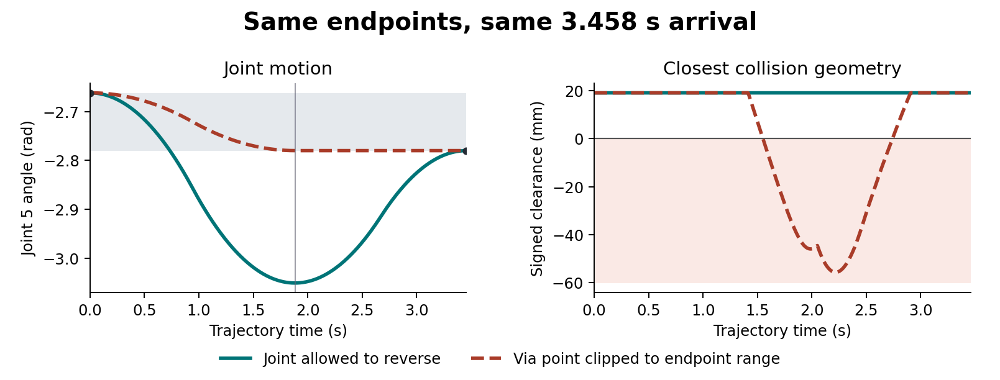

# 固定到达时刻的七自由度机械臂避障规划

**论文问题**　当机械臂沿两端点之间的关节空间直线会碰撞时，有多少任务仍然可以在无障碍理论最短时间内绕过障碍？哪些收益确实来自关节时序，哪些来自后续的几何搜索？前一个问题决定轨迹有多快，后一个问题决定论文可以把功劳归给哪一部分。[冻结的实验协议](../../benchmarks/generic_motion_v1/results/phase_search/protocol.json)

## 问题选择与已有工作

| 维度 | 本研究的判断 |
|---|---|
| Vision · 研究视野 | 对固定端点、静态已知障碍和给定运动限值，解释一次绕障究竟是否必须付出执行时间。即使两条轨迹都可行，这个问题仍能区分规划质量。 |
| Taste · 科研取舍 | 主问题放在最短执行时间。固定到达时刻和候选数可以单独检验关节协调的贡献。最短路径保留为独立副赛道，因为关节绕行常常增加长度。 |
| Insight · 核心洞察 | 最慢的关节决定到达时间，其余关节可能有余量。调整这些关节何时移动，可以改变七维路径。单调调时始终困在端点构成的轴对齐盒内；若必须越出该盒，具有余量的关节可以尝试先反向再返回。 |
| Importance & Novelty · 重要性与新颖性 | 固定时间转向、各关节同步和加速度有界插值均有先例。本文要检验的增量是，在同一最短到达时间内，哪类受限搜索能给出此前候选族找不到的避障轨迹。各方法解决的具体问题、配对胜负和额外代价都需可查。 |
| Solidity · 证据链 | 从解析可达条件出发，给出真实碰撞反例，按相同候选预算做局部对照，再用冻结的整机验证器比较端到端表现。三层证据分别回答能否发生、为何发生和能否改善完整规划。 |

Hauser 与 Ng-Thow-Hing 已用多关节固定时长插值构造有界加速度捷径，应列为解析对照。LaValle 等讨论了固定时长转向解的非唯一性。ARMTD 已研究参数化机械臂轨迹的避障约束。Steinegger 等还提出在检测到碰撞的时刻，从既有 RRT 路径取中间点并拼接运动基元。本研究在固定下界时刻直接求可行中间位置区间，保留其他轴的原时序。先验工作已覆盖“遇障时插入中间点”这一思路。[ICRA 2010](https://motion.cs.illinois.edu/papers/icra10-smoothing.pdf) · [Bang-Bang Boosting of RRTs](https://arxiv.org/html/2210.01744) · [ARMTD](https://arxiv.org/abs/2002.01591) · [CDC–ECC 2011，第 IV 节](https://skoge.folk.ntnu.no/prost/proceedings/cdc-ecc-2011/data/papers/1256.pdf) · [Supervisor-Skills 技术论文模板](https://github.com/HKUSTDial/Supervisor-Skills/blob/4bd3fef393e5ffc891c74309a5ef6c5ad3ad12c8/handbook/03_Paper_Writing/3.3_技术类Full_Paper思考模板.md)

## 方法与可证伪的预测

协议固定 Kinova Gen3 的七维端点、初末速度为零，以及逐轴速度和加速度上限。本题库速度上限为 1 rad/s，加速度上限为 1 rad/s²。这里的执行时间对应该运动学模型；负载、驱动力矩及 jerk 约束不在本次评测协议内。设第 $i$ 轴位移绝对值为 $d_i$，上限为 $v_i,a_i$。先忽略障碍，单轴先加速再制动，若达到速度上限则在两者之间匀速。于是任何满足上述约束的轨迹都需要至少 $L$ 秒。

$$
t_i=\begin{cases}2\sqrt{d_i/a_i},& d_i\le v_i^2/a_i,\\
d_i/v_i+v_i/a_i,& d_i>v_i^2/a_i,\end{cases}
\qquad L=\max_i t_i.
$$

1. **已冻结的端到端方法。** 首先检查同步直线。遇到碰撞时，保留限制轴的速度曲线，在其他轴的余量内尝试延迟启动或延长运动。时间赛道优先返回在 $L$ 处通过筛查的候选；局部搜索也允许放宽到达时刻。后续依次尝试中间点、可见图和 OMPL RRTConnect 种子，再按赛道缩短路径或优化时长。所有步骤共享预算，返回值须通过共同验证器。每条记录保存候选来自哪个阶段。[规划器](../../benchmarks/generic_motion_v1/runners/phase_search.py) · [优化步骤](../../benchmarks/generic_motion_v1/runners/phase_refinement.py)
2. **碰撞位置能否指导重新调时？** 给定局部碰撞见证，沿有符号距离对调时参数的一阶导数修正运动。设运动时长为 $h_i=t_i+w_i(L-t_i)$，延迟为 $b_i=s_i(L-h_i)$，局部相位为 $u_i=(t-b_i)/h_i$。修正方向由 $\partial q_i/\partial s_i=-\dot q_i(L-h_i)$ 和 $\partial q_i/\partial w_i=\dot q_i(s_i-u_i)(L-t_i)$ 给出。使用有界步长，采样复检整条轨迹。一处碰撞消失后可能产生另一处，因此与均匀随机调时按相同候选数配对。[推导的可执行实现](witness_clocks.py)
3. **有时间余量的关节能否暂时反向？** 先取关节空间直线上的碰撞构型，再用限制轴到达该位置的物理时刻 $\tau$，对选中的轴构造中间位置 $z_i$，让该轴在此处速度为零。时长 $t$ 内从静止出发并静止到达的最大位移为 $R_i(t)=a_it^2/4$（$t\le 2v_i/a_i$），更长时为 $v_i(t-v_i/a_i)$。因此从起点和终点分别计算半径，将两区间与关节限位相交，得到可用的 $z_i$。允许它落在两端点之外；紧约束轴继续原运动。拼接两段解析曲线后检查全臂碰撞。固定在见证时刻停住某轴会限制解集，所以比较时记录新增解决、丢失解决和计算代价。[单次反向实现](excursions.py)

## 实验和判断

**完整规划。** Dev 有 60 道合法题、20 个布局，分属四类有新增障碍的场景，每题用种子 0、1、2。单 GPU 串行、60 秒/查询。成功率的分母保留全部合法调用，代价只在同题同种子共同成功时配对，95% 区间以布局为抽样单位。物理执行时间、冷启动规划时间、路径长度分别统计。碰撞结论来自固定模型上的有限数值检查。EI-ZO 使用 Werner 等提出的基于凸区域的基线，在本项目的 Kinova 题库上运行。[Werner 等，RSS 2025](https://www.roboticsproceedings.org/rss21/p045.html) · [原始对照表](../../benchmarks/generic_motion_v1/results/phase_search/dev-comparison/paired.csv)

| Dev 对照 | 数值成功，本方法 / 对照 | 共同成功 | 配对均值差，本方法减对照（95% 区间） |
|---|---:|---:|---|
| 路径 · RRTConnect | 147 / 146（各 180 次） | 146 | −1.315 rad［−1.948，−0.731］ |
| 时间 · EI-ZO + SCSTO | 147 / 131（各 180 次） | 131 | −1.303 s［−1.610，−1.050］ |
| 时间 · NTO refined | 147 / 116（各 180 次） | 116 | +0.011 s［−0.104，+0.152］ |

两条赛道上，本方法的 Dev 成功次数均排第一。所有时间方法共同成功的 84 次里，NTO refined 平均 4.574 s，本方法为 4.607 s。所有路径方法共同成功的 37 次里，本方法、RRTConnect 和 RRT* 平均均为 4.640 rad。成功覆盖与共同成功时的质量分别报告。[完整排名和分母](../../benchmarks/generic_motion_v1/results/phase_search/dev-comparison/summary.json)

**归因。** 一个 Smoke 实例在同步直线处测得最小间隙 −4.698 mm。改变关节时序后，到达时间同为 4.84255 s，独立 Drake 以 0.0025 rad 步长加密复核，3,111 个样点的最小间隙为 +1.788 mm。Dev 三个种子共有 75/180 次达到 $L$（容差 1 µs），其中 36 次来自直线碰撞的 15 道不同题。种子 0 启用或关闭时序模块均成功 49/60 次；达到 $L$ 的次数为 25 对 18，放宽至距 $L$ 50 ms 则为 30 对 32。完整方法的成功率不能归因于时序模块一项。[实例与轨迹出处](../../benchmarks/generic_motion_v1/results/phase_search/mechanism/example.json) · [消融记录](../../benchmarks/generic_motion_v1/results/phase_search/clock_ablation-comparison/summary.json)

**机制对照。** Dev 的 47 道直线碰撞题中，先按固定哈希从四类布局各取 3 道，再检验剩余 35 道。两组题目不重叠，部分共享场景。保持 $T=L$、种子 0，每种随机策略限 25 个候选，最小峰值加速度的解析对照每题仅产生 1 条。记录全部候选，使用 CPU Drake 碰撞筛查，并以原模型的有符号距离逐一复核成功候选与导数约束。这个实验衡量固定时间的转向能力；全流程时间取自上面的 60 秒端到端评测。[先导原始结果](../../benchmarks/generic_motion_v1/results/phase_search/mechanism_control/comparison.json) · [剩余题结果目录](../../benchmarks/generic_motion_v1/results/phase_search/mechanism_control/dev-remainder)

| 固定 $T=L$ 的局部策略 | 首批 12 题 | 其余 35 题 | 总计 |
|---|---:|---:|---:|
| 单条解析最小峰值加速度插值 | 0 | 1 | 1/47 |
| 随机选择提前或延后 | 1 | 10 | 11/47 |
| 均匀随机时移 | 3 | 9 | 12/47 |
| 冻结方法的碰撞方向引导 | 2 | 10 | 12/47 |
| 用碰撞点一阶导数修正 | 1 | 10 | 11/47 |
| 本文候选 · 允许单次反向 | **4** | **11** | **15/47** |
| 预先指定的交替策略（13 次原引导、12 次反向候选） | 1 | 10 | 11/47 |

第二组中一阶修正和原引导解出完全相同的 10 题，分别用了 421 次和 35 次梯度计算。按当前证据，均匀调时是强对照。冷启动端到端规划约耗时 11.20 s（路径）和 11.32 s（时间）；在时间赛道，本方法平均比 EI-ZO 多花 1.99 s 计算，却能在共同成功题上减少轨迹执行时间。

**反向动作的证据。** 相比原引导，单次反向共多解 4 题、少解 1 题。47 题分属 19 个布局，配对成功差为 +6.4 个百分点，按布局重抽样的描述性 95% 区间为［−2.3，+18.4］。首批有两道题的五个常规对照均未找到轨迹。后续 35 题中，反向候选解出的 11 题恰好是原引导与均匀时移分别用足 25 次时解出题目的并集。交替策略只使用前 12 个反向候选，漏掉首批全部反向命中。区分“找到一种此前未命中的具体运动”与“在新布局上有稳定成功率优势”，能避免误判。[12 题及逐题记录](../../benchmarks/generic_motion_v1/results/phase_search/excursion_pilot/comparison.json) · [35 题及逐题记录](../../benchmarks/generic_motion_v1/results/phase_search/excursion_pilot/dev-remainder/comparison.json) · [布局配对区间](../../benchmarks/generic_motion_v1/results/phase_search/paper_design/paired_mechanism.json)

**一个可以复验的反事实。** 下图取首批中五种常规对照均未命中的题，按题号排序选择第一题，再取首条命中轨迹。灰带是第 5 关节两端点之间的范围。实线允许该关节先越过目标角度再返回，虚线仅将中间角度夹回灰带。两条轨迹均在 3.458 s 到达，两者的最小采样间隙分别为 +19.03 mm 和 −55.69 mm。



对全部 81 条 CPU 通过的轨迹重复相同操作，64 条曾越出端点盒，夹回后有 23 条碰撞，58 条继续通过；每条都仍满足运动限值。原来有成功轨迹的 15 道题中，10 道在这些候选的夹回版本中仍有成功轨迹。该比较给出了在特定曲线上改变中间位置的结果；判断一道题是否存在其他盒内可行路径仍需额外证据。[逐轨迹反事实记录](../../benchmarks/generic_motion_v1/results/phase_search/paper_design/endpoint_box.json) · [复现代码](endpoint_box.py)

最初对解析可达区间人为内缩，使相邻切换时刻极接近，放大了 Bézier 控制点二阶差分的舍入误差。修复使用原解析闭区间，原验证容差保持不变。新实现通过 12 题回归，并在余下 35 题使用同一源码。第一轮轨迹、失败与代码均已保存。[首次实验](../../benchmarks/generic_motion_v1/results/phase_search/excursion_pilot/pre_correction) · [数值回归](test_excursions.py)

**小规模端到端对照。** 在 12 道先导 Dev 题上，用同一随机种子分别运行原引导与反向候选，每臂每题一个全新进程。唯一改动是用 25 个反向候选替换 $T=L$ 的 25 个原候选。两臂以相同的粗采样关节长度顺序密检；余下时长倍率 1.25、1.6、2.1 以及可见图、RRT 和优化阶段共用原代码。建候选、筛查、求解和最终验证均计入每臂 60 s。已在真实 Dev 模型上以 CPU 几何检查跑通原规划器的求解入口，并回读保存的轨迹；对应的 GPU 对照与正式 Test 分开封存。[端到端对照入口](excursion_e2e.py) · [集成样例记录](../../benchmarks/generic_motion_v1/results/phase_search/excursion_e2e_cpu_integration/cpu_integration.json)

新分支的判断依据是相同预算下能否多解决不同布局的直线碰撞题，以及优势能否经共同验证器、按实际计算时间再次观察到。命中解析界的次数、相对差距 $(T-L)/L$、10/50/100 ms 敏感性和超时失败分别报告。已用过的本地 Test 只评估冻结实现。在独立题库及强对照上的结果决定论文结论能推广多远。

## 正式结果

冻结方法 PHASE_SEARCH 在 395 道合法 Test 题上各运行三个种子，路径赛道通过 1,084/1,185 次，时间赛道通过 1,085/1,185 次。计入生成无效输入的 150 个赛道与种子组合后，登记的 2,520 次调用均已封存。[逐题成绩](../../benchmarks/generic_motion_v1/results/phase_search/test-comparison/legal_records.csv) · [同题配对结果](../../benchmarks/generic_motion_v1/results/phase_search/test-comparison/paired.csv) · [完整性验证](../../benchmarks/generic_motion_v1/results/phase_search/test/verification.json)

允许反向的实验分支有 81 条 Dev 候选通过正式 CUDA 与 Drake 数值复核。12 题双臂端到端对照目前只有 CPU 集成记录，尚无 GPU 端到端成绩。[81 条逐轨迹复核记录](../../benchmarks/generic_motion_v1/results/phase_search/excursion_pilot/numerical_validation.csv)

## 复查

在仓库根目录执行。以下核验及状态命令使用本机的原始运行目录 `runs/phase_search/`。Git 中包含逐题成绩、汇总表和关键轨迹，便于直接查看。前两条只读核验已保存的调时对照。从零重跑对照时，移除这两条命令中的 `--verify-existing`，再运行反向候选实验。反向候选的 CPU 实验支持按已存记录续跑；GPU 复核单独排队，并与正式规划共用同一设备锁。

```bash
bash local/python.sh -m experiments.joint_timing.cohort --cohort pilot --verify-existing
bash local/python.sh -m experiments.joint_timing.cohort --cohort dev-remainder --verify-existing
bash local/python.sh -m pytest -q experiments/joint_timing benchmarks/generic_motion_v1/tests/test_phase_search.py
CUDA_VISIBLE_DEVICES="" OMP_NUM_THREADS=1 bash local/python.sh -m experiments.joint_timing.excursion_pilot --cohort pilot
CUDA_VISIBLE_DEVICES="" OMP_NUM_THREADS=1 bash local/python.sh -m experiments.joint_timing.excursion_pilot --cohort dev-remainder
CUDA_VISIBLE_DEVICES="" bash local/python.sh -m experiments.joint_timing.verify_witnesses status
bash local/python.sh -m experiments.joint_timing.excursion_e2e status
bash local/python.sh scripts/evaluate.py status --run runs/phase_search/test
```
